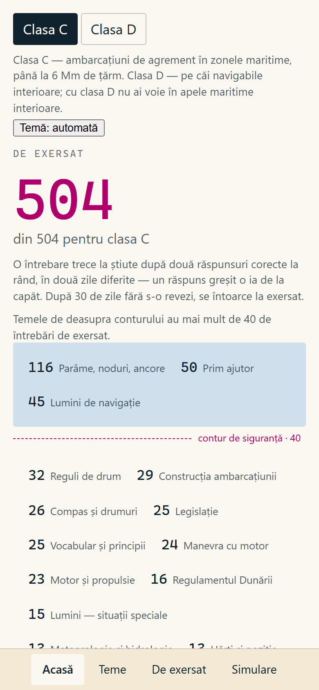
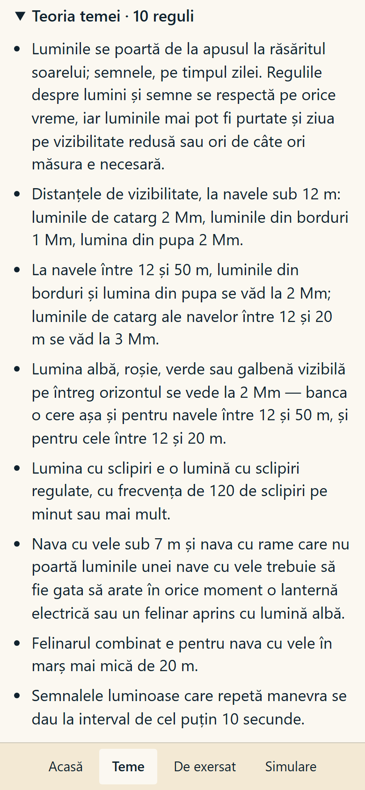
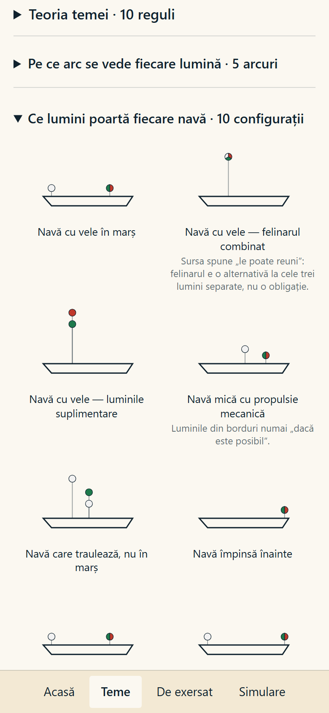
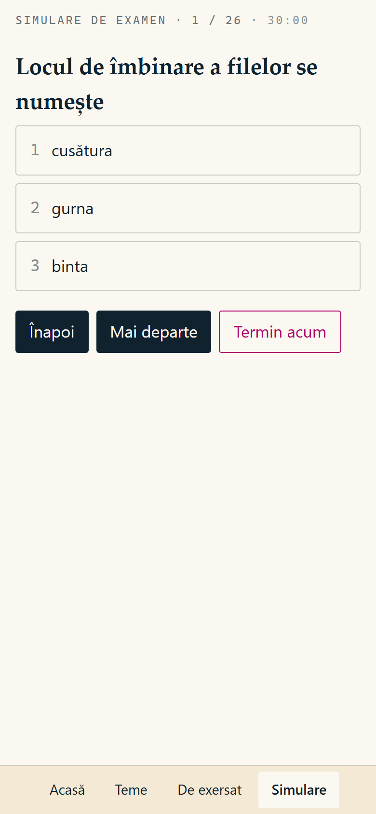

# permis-ambarcatiuni — boating licence exam trainer

**An offline study app for the Romanian leisure-craft licence exam (classes C and D), built from the official question lists by a tested, deterministic pipeline.** One HTML file, works on a phone with no network, made for a real candidate.

<p>
  
  
  
  
</p>

## What it does

- **603 questions** from the official ANR lists (504 for class C, 366 for D, 267 shared) — no invented questions or distractors.
- **Study by theme: theory → drawing → drill.** 20 themes; the questions you still need come first.
- **Exam simulation** with the official mix: 26 questions, 30 minutes, pass mark 22 (Order MT 427/2026). Also the 10-question "difference exam" for adding the second class.
- **A question counts as known** after two correct answers in a row on two different days; a wrong answer resets it, and 30 days without review sends it back. The headline metric is *how many questions are still to practise*, not an average score.
- **Drawings and sound signals generated in code** — navigation lights, light arcs, compass roses, hull sections, buoys, Web Audio horn signals — straight from the regulation, with zero image or audio assets.

The app UI and content are in Romanian, like the exam.

## How it is built

```
ANR PDFs ──▶ extract ──▶ normalise + dedup ──▶ structure ──▶ themes ──▶ audit ──▶ questions.json ──▶ single HTML
            (PyMuPDF,     (one item = stem +   (discipline     (theory      (fails the
             ruled cells)  its option set)      by number       cards,       build on any
                                                ranges)         drawings)    broken rule)
```

Things that took real work, and are covered by tests:

- **Table extraction from the official PDFs.** The two lists rule their columns differently; one has a 2-pt column whose digits glued onto option text, and one row used to absorb text from 500 pt further down the page. Each fix has a regression test on the real row.
- **What counts as one question.** The bank repeats the same stem with different option sets as separate questions; grouping by stem alone loses 47 of them. Item ids are a hash of the normalised stem plus the sorted options, so saved progress survives reordering of the source.
- **Gaps in the official numbering are real** (ANR deleted questions and kept the numbers), so the audit deliberately does not check numbering continuity.
- **Theory must be backed by the bank.** Every sentence in a theory card carries quotes extracted (never retyped) from the questions it answers; the audit fails the build if a quote is missing from the bank or comes from another theme. Showing a rule only to the class whose exam asks it is enforced by tests, and the cases no automatic check can see are caught by reading the quotes.
- **Drawings are checked against the bank too:** every number and every word printed on a drawing must appear in the bank. Three drawings were refused because the bank does not give enough to draw them honestly (knots, chart points, propeller walk).
- **Deterministic build:** the same sources produce the same bytes.

## Data

The official documents are **not** in this repository. They are published by Autoritatea Navală Română (rna.ro):

- the question lists for leisure craft, class C and class D → `sources/anr/lista_C.pdf`, `sources/anr/lista_D.pdf`
- Order MT no. 427 of 23 April 2026 and the exam methodology (reference only)

Theory cards quote short passages from those lists as citations. Third-party course material used locally as background reading is not included.

## Build and test

```bash
python -m venv .venv
.venv/Scripts/python -m pip install -e ".[dev]"
.venv/Scripts/python -m caa.cli     # bank -> build/questions.json (exit 1, nothing written, if the audit fails)
.venv/Scripts/python -m caa.app     # app  -> build/permis-ambarcatiuni.html (one file, no external requests)

.venv/Scripts/python -m pytest -q   # 284 tests; 102 need the ANR lists and are skipped without them
node --test tests/js/*.test.js      # 101 tests for the app logic and renderers
```

Design notes, in Romanian: [`docs/superpowers/specs/`](docs/superpowers/specs/).

## Built with

Python, PyMuPDF, pytest, vanilla JavaScript, inline SVG, Web Audio, Node's test runner. Designed and built by me with Claude Code as a coding assistant.

## License

Code: MIT. The official question texts belong to their publisher.
